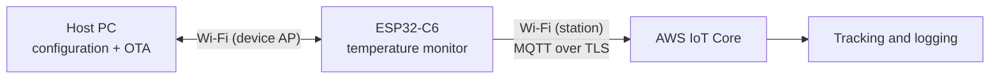

# IoT Condition Monitor

An ESP32-C6 temperature monitor that publishes readings to AWS IoT Core. The device runs a Wi-Fi access point so a host PC can configure it (Wi-Fi credentials, OTA updates), and connects to your Wi-Fi network as a station to reach the cloud.


## Features

- Temperature readings from DHT22 published to AWS IoT Core over MQTT with TLS (mutual authentication)
- Built-in access point for local configuration from a host PC
  - set Wi-Fi credentials
  - push OTA firmware updates
- Station mode for the uplink to AWS IoT
- SNTP time sync
- NVS for sta credential persistence
- LED WiFi status

## How it works



1. The device starts its access point. Connect your PC to it to provide Wi-Fi credentials or upload firmware. 
2. Using the saved credentials, the device joins your Wi-Fi network as a station.
3. It connects to AWS IoT Core with its device certificate and publishes temperature.
4. Readings are tracked and logged in AWS. 

## Hardware

| Item | Details |
|---|---|
| Board | ESP32-C6 DevKitC-1 |
| Sensor | DHT22 half-duplex, single-data-line protocol |
| Wiring | **TODO: pin table** |

## Requirements

| Component | Version |
|---|---|
| Target | ESP32-C6 |
| ESP-IDF | **v5.5.6** |
| esp-aws-iot | `release/v3.1.x` @ `<commit>` (git submodule) |
| Managed components | see `dependencies.lock` (e.g. `espressif/led_strip`) |

The esp-aws-iot commit is recorded by the submodule. Show it with `git submodule status`.

Newer ESP-IDF releases are untested with this project. Set up ESP-IDF following the [official guide](https://docs.espressif.com/projects/esp-idf/en/latest/get-started/index.html), and check out the tag above:

```bash
cd ~/esp-idf
git checkout v5.5.6
git submodule update --init --recursive
./install.sh esp32c6
```

## Getting started

### 1. Clone with submodules

```bash
git clone --recursive <repo-url>
cd iot-condition-monitor
```

If you cloned without `--recursive`:

```bash
git submodule update --init --recursive
```

### 2. Add your AWS credentials

The firmware embeds three files from `main/certs/`. They are **not** in the repository. See [`main/certs/README.md`](main/certs/README.md) for what they are and how to get them.

### 3. Build

Open a fresh terminal (one ESP-IDF version per shell):

```bash
. ~/esp-idf/export.sh
idf.py set-target esp32c6
idf.py build
```

### 4. Flash and monitor

```bash
idf.py -p /dev/ttyACM0 flash monitor     # or /dev/ttyUSB0, depending on the board
```

Exit the monitor with `Ctrl+]`. If flashing cannot connect, hold BOOT, tap RESET, release BOOT, and retry.

On WSL2, USB devices must be attached first with [usbipd-win](https://github.com/dorssel/usbipd-win): `usbipd attach --wsl --busid <BUSID>` from an admin PowerShell.

## Configuration

Project settings live in `sdkconfig.defaults` (committed). 
Editing `sdkconfig.defaults` has no effect once a generated `sdkconfig` exists. Delete `sdkconfig` and reconfigure:

```bash
rm sdkconfig
idf.py reconfigure
```

## AWS IoT setup

1. In the AWS IoT Core console, create a **Thing** for the device.
2. Create and activate a **certificate** for it, and download the device certificate and private key. The private key can only be downloaded when the certificate is created.
3. Create an **IoT policy** and attach it to the certificate. Scope it to your client ID and topic, for example:

   ```json
   {
     "Version": "2012-10-17",
     "Statement": [
       {
         "Effect": "Allow",
         "Action": "iot:Connect",
         "Resource": "arn:aws:iot:<region>:<account-id>:client/<client-id>"
       },
       {
         "Effect": "Allow",
         "Action": "iot:Publish",
         "Resource": "arn:aws:iot:<region>:<account-id>:topic/<your-topic>"
       }
     ]
   }
   ```

4. Attach the certificate to the Thing, and note your account's **device data endpoint**.
5. Put the credential files in `main/certs/` as described in its README.

To check that data is arriving, subscribe to the topic in the console's **MQTT test client**.

## Project structure

```text
.
├── CMakeLists.txt
├── dependencies.lock          # pinned managed components
├── sdkconfig.defaults         # committed project settings
├── components/
│   └── esp-aws-iot/           # git submodule (AWS IoT Device SDK for ESP32)
└── main/
    ├── CMakeLists.txt
    └── certs/                 # AWS credentials (gitignored, see its README)
```

## Known limitations

- **Legacy AWS IoT SDK.** The project uses the 3.x API of the AWS IoT Device SDK (`release/v3.1.x` of esp-aws-iot). Upstream no longer maintains 3.x. A migration to the current LTS (coreMQTT) API is planned. See AWS's [MQTT migration guide](https://aws.github.io/aws-iot-device-sdk-embedded-C/latest/docs/doxygen/output/html/mqtt_migration.html).
- **TODO: other known issues**

## Security

- Never commit `main/certs/` contents. The `.gitignore` excludes them.
- If a private key is ever exposed or lost, deactivate that certificate in